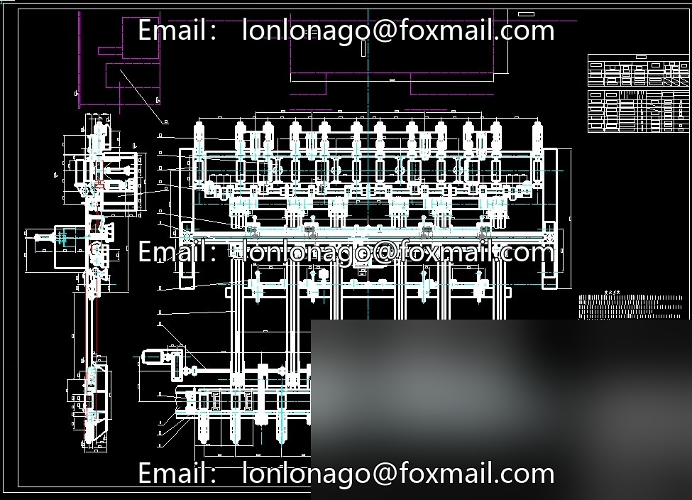
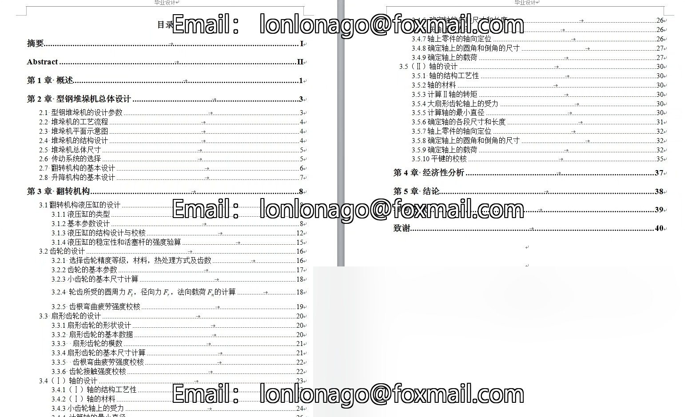
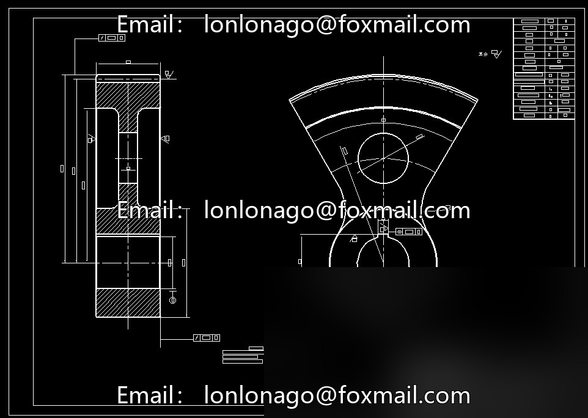
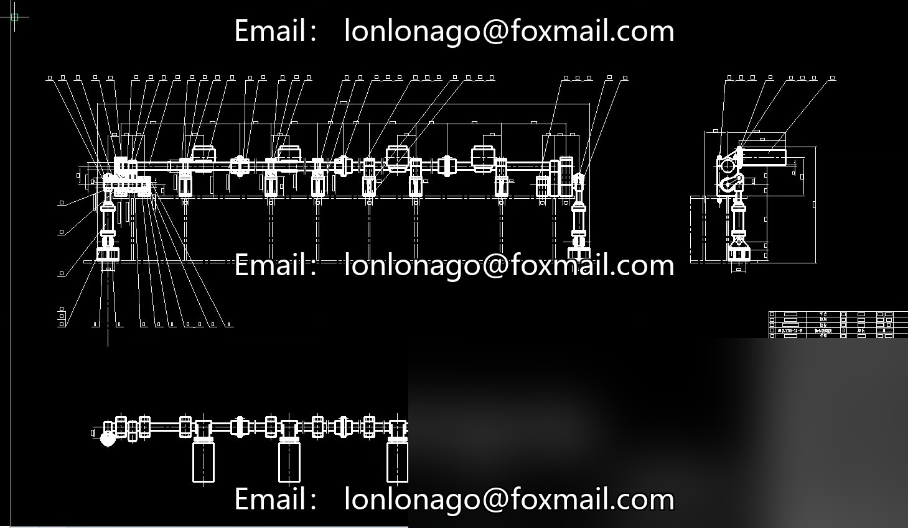
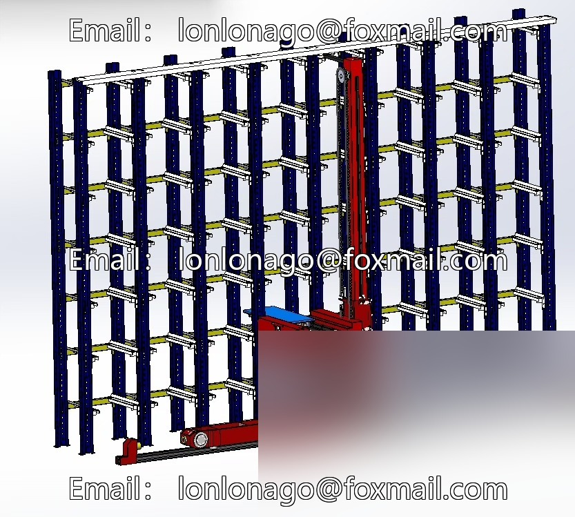

# Design of steel profile stacker; design drawing of steel profile stacker; design CAD drawing of steel profile stacker

## Body

Design of a stacker for steel sections; stacker design diagram; stacker design CAD diagram
57 Contains assembly drawings, part drawings, and design descriptions
It details the overall design theory and entire stacking process of the steel section stacker, focusing on the design of the flipping mechanism. It mainly covers the overall design of the flipping mechanism's axle, gear, and hydraulic cylinder, including the selection of bearings, the selection, and verification of the coupling.
In addition, a 3D model of a similar-structure stacker is provided for free, for specific reference, refer to the attached figures

The design drawings and CAD files cover assembly drawings, parts and design descriptions, the overall design theory and stacking process, with focus on the flip mechanism and the designs of axes, gears, hydraulic cylinders, bearings, coupling and other components; a 3D model similar to the structure is also provided.

<!-- AI_ENRICHED -->

## Images

## Payment

Here is a pay link on Stripe ( https://buy.stripe.com/3cs8yP7sY87d0vu9AB ). Please contact me lonlonago@foxmail.com after funding $89, and I will send you a complete data files , thank you!

